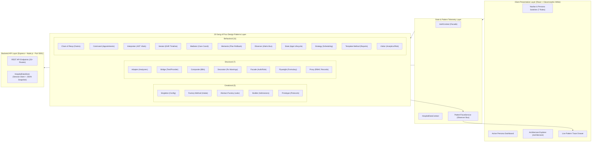

# MediFlow: 23 GoF Design Patterns Hospital Management System

[](https://www.typescriptlang.org/)
[](https://react.dev/)
[](https://vitejs.dev/)
[](https://nodejs.org/)
[](#-comprehensive-23-gof-patterns-deep-dive--tradeoffs)
[](#-glassmorphic-white-ui-design-system)

**MediFlow** is an enterprise-grade Clinical Workflow & Hospital Management Proof of Concept (POC) demonstrating the practical, production-grade application of **all 23 Gang of Four (GoF) Design Patterns**.

Built with a **Glassmorphic White** interface, **7 distinct persona dashboards**, an **in-memory session-persistent backend with disk snapshots**, and a **real-time Live Pattern Trace engine**, MediFlow allows healthcare staff, developers, and architects to observe design pattern execution in real time as patients move through clinical triage, consultation, diagnostics, inpatient ward telemetry, medication dispensing, and insurance adjudication.

---

## 📑 Table of Contents
1. [System Architecture & Core Philosophy](#-system-architecture--core-philosophy)
2. [Quick Start & Launch Guide](#-quick-start--launch-guide)
3. [Step-by-Step Complete Demo Walkthrough](#-step-by-step-complete-demo-walkthrough)
4. [Comprehensive 23 GoF Patterns Deep-Dive & Tradeoffs](#-comprehensive-23-gof-patterns-deep-dive--tradeoffs)
   - [Creational Patterns (5/5)](#1-creational-patterns-55)
   - [Structural Patterns (7/7)](#2-structural-patterns-77)
   - [Behavioral Patterns (11/11)](#3-behavioral-patterns-1111)
5. [7 Persona Capabilities Matrix](#-7-persona-capabilities-matrix)
6. [Live Observability & Architecture Explorer](#-live-observability--architecture-explorer)
7. [Glassmorphic White UI Design System](#-glassmorphic-white-ui-design-system)

---

## 🏛️ System Architecture & Core Philosophy

MediFlow is architected around two coupled layers:
1. **The Clinical Domain Layer**: High-fidelity representations of Electronic Health Records (EHR), Vital Signs telemetry, Diagnostic Orders, Prescription Formularies, Inpatient Ward Admissions, and Insurance Claims.
2. **The GoF Architectural Layer**: A pure, decoupled TypeScript pattern execution framework where every clinical operation is dispatched through a GoF design pattern rather than ad-hoc procedural scripts.



---

## 🚀 Quick Start & Launch Guide

### Prerequisites
- **Node.js**: v18.0.0 or later
- **npm**: v9.0.0 or later

### 1. Start the Backend Server (Port 5001)
```bash
cd server
npm install
npm run start
```
*The backend starts at `http://localhost:5001`. On first run, it initializes rich clinical seed data and persists state across sessions to `server/data_snapshot.json`.*

### 2. Start the Frontend Client (Port 5173)
In a separate terminal window:
```bash
cd client
npm install
npm run dev -- --host 127.0.0.1 --port 5173
```
*Open your browser and navigate to `http://127.0.0.1:5173/`.*

---

## 🎬 Step-by-Step Complete Demo Walkthrough

Follow this scripted 10-minute end-to-end walkthrough to demonstrate the full cross-persona clinical flow and observe all 23 GoF patterns:

### Stage 1: Receptionist Triage & Patient Intake (Factory Method, Strategy, Command, State)
1. **Switch Persona**: Click **"Reception"** in the top navigation bar.
2. **Register Emergency Patient (Factory Method)**:
   - Click **"Register New Patient (Factory)"**.
   - Select the **"Emergency Trauma"** creator card (`EmergencyPatientCreator`).
   - Enter name `Eleanor Vance`, Age `58`, Blood Group `O+`, Diagnosis `Severe retrosternal chest pain with diaphoresis`.
   - Click **"Execute Factory & Register Patient"**.
   - *Observation*: The patient is created with `priority: CRITICAL` and status `IN_CONSULTATION` automatically.
3. **Schedule Appointment (Strategy & Command)**:
   - Click **"Book Appt"** next to `Eleanor Vance`.
   - Select **"Least Busy Doctor"** (`LeastBusyStrategy`).
   - Select Department `Cardiology`.
   - Click **"Execute Command & Book Appointment"**.
   - *Observation*: `LeastBusyStrategy` selects the physician with lowest patient load; `BookAppointmentCommand` registers the appointment.
4. **Test Undo (Command)**:
   - Click **"Undo Last Action (Command)"** in the top bar to watch the command roll back. Re-book to proceed.
5. **Check-In Patient (State)**:
   - In the "Live Appointments" right sidebar, click **"Check In Patient"**.
   - *Observation*: State transitions from `SCHEDULED` → `CHECKED_IN`.

---

### Stage 2: Attending Physician Consultation (Prototype, Memento, Flyweight, Decorator, Bridge, Adapter, Builder, Iterator)
1. **Switch Persona**: Click **"Doctor"** (Dr. Robert Vance, MD).
2. **Inspect Longitudinal Record (Iterator)**:
   - Click **"Medical Timeline (Iterator)"** to traverse past encounters, lab analyses, and surgeries chronologically.
3. **Clone Clinical Protocol Prototype (Prototype)**:
   - Click **"Clone Prototype Template"**.
   - Select **"Post-Acute Coronary Syndrome & Stent Protocol"** (`CardiacCarePrototype`).
   - Click **"Deep-Clone Template"**.
   - *Observation*: An independent deep copy is instantiated without mutating the master hospital template.
4. **Capture Version Snapshot & Rollback (Memento)**:
   - In the Treatment Plan editor, add `Carvedilol 12.5mg` to the medication list.
   - Enter revision note `Added beta blocker following echo findings` and click **"Capture Memento"**.
   - Click **"Version History (v2)"** and click **"Rollback State"** to verify instantaneous rollback to v1.
5. **Order STAT Diagnostic Test (Abstract Factory, Bridge, Adapter)**:
   - Click **"Order Lab Test (Bridge)"**.
   - Select Modality `Blood Chemistry & Biomarkers`, Test `High-Sensitivity Troponin I & CK-MB`, Provider `Internal Hospital Core Lab (Cobas e411)`, Priority `STAT`.
   - Click **"Dispatch Order via Bridge & Adapter"**.
6. **Enrich Prescription (Flyweight & Decorator)**:
   - Click **"Prescribe Drug (Decorator)"**.
   - Select `Lipitor (Atorvastatin Calcium)` from the Flyweight formulary.
   - Enter Dosage `80 mg PO` (`DosageDecorator`), Timing `Once daily at bedtime` (`TimingDecorator`), Directions `Take with water after dinner` (`FoodInstructionDecorator`), and Warning `Avoid grapefruit juice and monitor for myopathy` (`WarningDecorator`).
   - Click **"Enrich with Decorators & Prescribe"**.
7. **Construct Inpatient Admission (Builder)**:
   - Click **"Inpatient Admit (Builder)"**.
   - Select Ward `Cardio Inpatient Ward 3`, Room `Room 302`, Bed `Bed C-04`, Priority `HIGH`, Reason `Continuous telemetry and post-infarct monitoring`.
   - Click **"Build Admission via Builder Pattern"**.

---

### Stage 3: Inpatient Nursing & Telemetry (Interpreter, Mediator, Observer)
1. **Switch Persona**: Click **"Nurse"** (Elena Rostova, RN).
2. **Evaluate Vital Signs (Interpreter)**:
   - Under Vitals Telemetry, click preset **"Simulate Critical Shock (Pyrexia & Hypoxia)"** (Temp `39.6°C`, HR `124 bpm`, BP `88/56`, SpO2 `89%`).
   - Click **"Evaluate Vitals via Interpreter"**.
   - *Observation*: The clinical grammar AST evaluates expressions, triggering:
     - 🚨 `CRITICAL HYPOXIA ALERT: Oxygen saturation 89% < 92%`
     - 🚨 `HIGH PYREXIA ALERT: Core temperature 39.6°C > 39.0°C`
     - 🚨 `TACHYCARDIA ALERT: Heart rate 124 bpm > 100 bpm`
3. **Dispatch Acute Care Coordination (Mediator)**:
   - Click **"Dispatch Care Request (Mediator)"**.
   - Select Target `Central Hospital Pharmacy`, Urgency `EMERGENCY (STAT)`, Event `MEDICATION_REQUIRED`, Message `STAT IV Acetaminophen and Supplemental O2 Cannula required at Ward C-3 Bed 04`.
   - Click **"Route via Hospital Care Mediator"**.

---

### Stage 4: Laboratory Analysis & Diagnostics (Adapter, Observer)
1. **Switch Persona**: Click **"Laboratory"** (David Chen, MSc).
2. **Process Sample with Adapter**:
   - Locate the pending `High-Sensitivity Troponin I & CK-MB` order.
   - Click **"Run Adapter & Enter Results"**.
   - Enter measured value `1.84 ng/mL` (Reference `< 0.014 ng/mL`).
   - Check **"Mark as CRITICAL Laboratory Alert"**.
   - Click **"Normalize via Adapter & Notify Observers"**.
   - *Observation*: The adapter normalizes sensor formats, updates the order, and dispatches an Observer notification to attending doctors.

---

### Stage 5: Pharmacy Dispensing (Flyweight, Decorator)
1. **Switch Persona**: Click **"Pharmacy"** (Priya Sharma, PharmD).
2. **Review Decorated Instructions & Dispense**:
   - Inspect the pending prescription for `Lipitor` with its stacked dosage, timing, food, and warning decorators.
   - Click **"Verify & Dispense Medication"**.
3. **Inspect Shared Formulary Pool (Flyweight)**:
   - Click the **"Shared Formulary Pool (Flyweight)"** tab.
   - Click any drug to inspect the shared intrinsic monograph (manufacturer, generic name, pregnancy category, black-box warnings) reused across all patient instances.

---

### Stage 6: Patient Accounts & Billing (Composite, Chain of Responsibility)
1. **Switch Persona**: Click **"Billing"** (Marcus Holloway).
2. **Generate Composite Invoice (Composite)**:
   - Click **"Create Composite Invoice (Composite)"**.
   - Select patient `Eleanor Vance`, enter Consultation `$350`, Diagnostics `$275`, Room `$1,350`, Pharmacy `$85`.
   - Click **"Build Composite Invoice"**.
   - *Observation*: Constructs a composite tree calculating recursive subtotal, tax, and grand total (`$2,226.00`).
3. **Adjudicate Claim Pipeline (Chain of Responsibility)**:
   - Click **"Submit Claim (Chain of Resp)"** on the invoice.
   - Enter Provider `BlueCross Health Assurance Corp`, Policy `BC-992384-H7`.
   - Click **"Execute Chain of Responsibility Validation"**.
   - *Observation*: Watch all 4 sequential pipeline stages execute:
     - ✅ `Stage 1: Policy Validation` (Active policy verified)
     - ✅ `Stage 2: Coverage Validation` (Inpatient 95% benefit schedule verified)
     - ✅ `Stage 3: Amount Limit Validation` (Amount within catastrophic cap)
     - ✅ `Stage 4: Document Validation` (Composite itemization verified)
     - 🎉 Claim **APPROVED** for `$2,114.70` (Confetti triggers!).

---

### Stage 7: Hospital Administration & Governance (Singleton, Visitor, Template Method)
1. **Switch Persona**: Click **"Admin"** (Dr. Arthur Pendelton).
2. **Update Global Policies (Singleton)**:
   - Navigate to **"System Config (Singleton)"**, modify the Hospital Name or Emergency Hotline, and click **"Save Global Singleton Configuration"**.
3. **Execute Double-Dispatch Analytics (Visitor)**:
   - Navigate to **"Analytics (Visitor)"** tab.
   - Click **"Execute Double-Dispatch Visitor"**.
   - *Observation*: `AnalyticsVisitor` and `ClinicalRiskVisitor` traverse all disparate hospital entities without modifying underlying entity schemas.
4. **Generate Certified Official Reports (Template Method)**:
   - Navigate to **"Certified Reports (Template)"** tab.
   - Click **"Generate Financial Report"** to run the invariant 4-step generation workflow (`collect` → `validate` → `process` → `format`).

---

### Stage 8: Live Telemetry & Architecture Explorer
1. Click **"Architecture Explorer"** in the top navbar.
   - Browse the 23-pattern matrix.
   - Filter by `Creational`, `Structural`, `Behavioral`.
   - Click **"Live Test"** on any pattern to execute real-time trace testing.
2. Click the floating **"Live Pattern Trace"** badge (bottom-right) to view the chronological stream of all design pattern executions generated during your demo session.

---

## 🔍 Comprehensive 23 GoF Patterns Deep-Dive & Tradeoffs

Below is the complete architectural reference for all 23 patterns implemented in MediFlow, detailing **why each pattern was chosen**, its **source code location**, and the **severe downsides of alternative approaches**.

---

### 1. Creational Patterns (5/5)

#### 1. Singleton Pattern
- **File**: [`client/src/patterns/creational/Singleton.ts`](file:///d:/Dev/Projects/patterns2/client/src/patterns/creational/Singleton.ts)
- **Module**: Hospital Governance & System Policies
- **Why This Pattern Was Selected**: Hospital-wide operational policies (bed capacities, trauma protocols, licensing numbers, working hours) must have exactly one source of truth across all 7 persona dashboards. Singleton guarantees centralized access and state consistency.
- **Downsides of Alternative Approaches**:
  - *Global Variables*: Prone to race conditions, accidental overwrites across modules, and lack lazy initialization or lifecycle encapsulation.
  - *Multiple Instantiations*: Would cause catastrophic clinical desynchronization (e.g., ICU beds showing available in Reception while occupied in Doctor view).

#### 2. Factory Method Pattern
- **File**: [`client/src/patterns/creational/FactoryMethod.ts`](file:///d:/Dev/Projects/patterns2/client/src/patterns/creational/FactoryMethod.ts)
- **Module**: Patient Triage & Intake
- **Why This Pattern Was Selected**: Patient intake varies significantly by clinical severity (`Regular`, `Emergency`, `Referred`). Factory Method delegates creation to specialized creator subclasses (`EmergencyPatientCreator` automatically assigns `CRITICAL` priority, assigns trauma bay, and initiates emergency consultation).
- **Downsides of Alternative Approaches**:
  - *Monolithic `if/else` or `switch` statements*: Violates Open/Closed Principle. Adding a new triage pathway (e.g., `TelehealthPatient` or `VIPIntake`) requires modifying core intake code, risking accidental triage regression in emergency paths.

#### 3. Abstract Factory Pattern
- **File**: [`client/src/patterns/creational/AbstractFactory.ts`](file:///d:/Dev/Projects/patterns2/client/src/patterns/creational/AbstractFactory.ts)
- **Module**: Diagnostic Pathology & Imaging
- **Why This Pattern Was Selected**: Diagnostic orders involve families of related clinical objects (Analyzer Protocols, Result Normalizers, Quality Assurance Checkers). Abstract Factory instantiates complete test families for `InternalLabFactory`, `ExternalLabFactory`, and `RadiologyFactory`.
- **Downsides of Alternative Approaches**:
  - *Ad-hoc Instantiation*: Risk of mismatched clinical objects (e.g., sending an internal Cobas reagent protocol to an external HL7 Quest partner), resulting in corrupted diagnostic orders and failed lab integration.

#### 4. Builder Pattern
- **File**: [`client/src/patterns/creational/Builder.ts`](file:///d:/Dev/Projects/patterns2/client/src/patterns/creational/Builder.ts)
- **Module**: Inpatient Ward Admissions
- **Why This Pattern Was Selected**: Inpatient admission is a complex object with over a dozen optional and mandatory attributes (ward, room, bed, telemetry leads, isolation requirements, diet restrictions, attending physician, priority). Builder enables step-by-step fluent construction with strict validation.
- **Downsides of Alternative Approaches**:
  - *Telescoping Constructors (`new Admission(p1, p2, p3...)`)*: Highly error-prone; a clinician or developer can easily transpose bed numbers and room numbers of identical string types.
  - *Naked Object Literals*: Allows creating incomplete, non-validated admissions with unassigned beds or missing physician IDs.

#### 5. Prototype Pattern
- **File**: [`client/src/patterns/creational/Prototype.ts`](file:///d:/Dev/Projects/patterns2/client/src/patterns/creational/Prototype.ts)
- **Module**: Clinical Protocol Templates
- **Why This Pattern Was Selected**: Standard clinical regimens (e.g., Acute Coronary Syndrome, Diabetic Ketoacidosis) contain complex pre-configured medication schedules, telemetry rules, and lab frequencies. Prototype deep-clones verified master templates into independent patient-specific plans without database roundtrips.
- **Downsides of Alternative Approaches**:
  - *Manual Copying / Re-keying*: Clinicians waste time re-entering 20+ baseline orders manually, leading to human typographic errors and omitted medications.
  - *Shallow Copying (`Object.assign`)*: Sub-arrays (medications, contraindications) remain referenced to the master template; editing one patient's plan would corrupt the master hospital protocol.

---

### 2. Structural Patterns (7/7)

#### 6. Adapter Pattern
- **File**: [`client/src/patterns/structural/Adapter.ts`](file:///d:/Dev/Projects/patterns2/client/src/patterns/structural/Adapter.ts)
- **Module**: Diagnostic Sensor & Vendor Normalization
- **Why This Pattern Was Selected**: Hospital equipment vendors speak incompatible formats (Roche Cobas uses proprietary sensor telemetry; Quest Diagnostics uses HL7 v2.5; Radiology uses DICOM metadata). `InternalLabAdapter`, `ExternalLabAdapter`, and `RadiologyAdapter` map these into a unified `LabOrder` interface.
- **Downsides of Alternative Approaches**:
  - *Vendor Code in Core UI*: Pollutes React components with vendor-specific parsing logic, coupling the entire hospital frontend to hardware vendor APIs.

#### 7. Bridge Pattern
- **File**: [`client/src/patterns/structural/Bridge.ts`](file:///d:/Dev/Projects/patterns2/client/src/patterns/structural/Bridge.ts)
- **Module**: Diagnostic Request & Provider Decoupling
- **Why This Pattern Was Selected**: Decouples the abstraction of *what* test is ordered (`BloodTestRequest`, `XRayRequest`, `MRIRequest`) from *who* executes it (`InternalDiagnosticProvider`, `ExternalDiagnosticProvider`, `RadiologyCenterProvider`). Either hierarchy can vary independently.
- **Downsides of Alternative Approaches**:
  - *Class Explosion via Multiple Inheritance*: Creating `InternalBloodTest`, `ExternalBloodTest`, `RadiologyBloodTest`, `InternalXRay`, `ExternalXRay`... creates an unmaintainable combinatorial matrix of $N \times M$ classes.

#### 8. Composite Pattern
- **File**: [`client/src/patterns/structural/Composite.ts`](file:///d:/Dev/Projects/patterns2/client/src/patterns/structural/Composite.ts)
- **Module**: Inpatient Billing Statements
- **Why This Pattern Was Selected**: Medical bills are hierarchical trees containing individual items (`BillItem` - e.g., Lipitor 40mg $12.00) grouped under departmental branches (`BillGroup` - e.g., "Pharmacy Supplies" or "Surgical Theatre"). Composite treats groups and leaf items uniformly, computing recursive totals and tax effortlessly.
- **Downsides of Alternative Approaches**:
  - *Flat Arrays with Custom Loops*: Difficult to support nested sub-departmental grouping, itemized insurance carve-outs, or department-level subtotals without brittle looping and special-case checking.

#### 9. Decorator Pattern
- **File**: [`client/src/patterns/structural/Decorator.ts`](file:///d:/Dev/Projects/patterns2/client/src/patterns/structural/Decorator.ts)
- **Module**: Prescription Clinical Enrichment
- **Why This Pattern Was Selected**: Base medications require dynamic, stacking clinical instruction layers depending on patient condition (`DosageDecorator`, `TimingDecorator`, `FoodInstructionDecorator`, `WarningDecorator`). Decorator allows arbitrary chaining of instructions at runtime without modifying the base drug object.
- **Downsides of Alternative Approaches**:
  - *Subclassing Explosion*: Creating `LipitorWithDosageAndWarning`, `LipitorWithFoodInstructions`, `LipitorWithAllDecorations` creates hundreds of redundant subclasses.
  - *Messy String Concatenation*: Unstructured string concatenation loses structured metadata required for interaction checks.

#### 10. Facade Pattern
- **File**: [`client/src/patterns/structural/Facade.ts`](file:///d:/Dev/Projects/patterns2/client/src/patterns/structural/Facade.ts)
- **Module**: Authentication & Persona Access Subsystem
- **Why This Pattern Was Selected**: Managing multi-persona clinical sessions involves complex subsystems (Credential Validation, Token Storage, Role Permission Matrix, Audit Trail Logging). `AuthFacade` exposes clean high-level methods (`login`, `switchPersona`, `hasPermission`) hiding subsystem complexity.
- **Downsides of Alternative Approaches**:
  - *Exposing Raw Subsystems to UI*: UI components would need to orchestrate 4 different services for every login, increasing code duplication and security oversight risks.

#### 11. Flyweight Pattern
- **File**: [`client/src/patterns/structural/Flyweight.ts`](file:///d:/Dev/Projects/patterns2/client/src/patterns/structural/Flyweight.ts)
- **Module**: Medication Formulary Catalog
- **Why This Pattern Was Selected**: In a hospital with thousands of active prescriptions, drug monographs (trade name, generic formula, manufacturer, molecular classification, black-box warnings) are immutable. Flyweight pools these objects in `MedicationFlyweightFactory`, sharing them across all patient instances while separating extrinsic dosage data.
- **Downsides of Alternative Approaches**:
  - *Duplicating Monograph Objects*: Duplicating large text monographs across 10,000 active prescriptions wastes significant memory and risks warning inconsistencies when formulary guidelines update.

#### 12. Proxy Pattern
- **File**: [`client/src/patterns/structural/Proxy.ts`](file:///d:/Dev/Projects/patterns2/client/src/patterns/structural/Proxy.ts)
- **Module**: Secure Patient Record Access (RBAC)
- **Why This Pattern Was Selected**: HIPAA regulations mandate strict role-based access control and immutable audit logging on sensitive medical records. `SecurePatientRecordProxy` intercepts calls to `RealPatientRecordService`, checks permissions, sanitizes records for unauthorized roles, and writes audit logs.
- **Downsides of Alternative Approaches**:
  - *Scattering Security Checks in UI Components*: If access checks are written inside React components, a missing check in a newly developed page exposes private clinical data directly.

---

### 3. Behavioral Patterns (11/11)

#### 13. Chain of Responsibility Pattern
- **File**: [`client/src/patterns/behavioral/ChainOfResponsibility.ts`](file:///d:/Dev/Projects/patterns2/client/src/patterns/behavioral/ChainOfResponsibility.ts)
- **Module**: Third-Party Insurance Claim Adjudication
- **Why This Pattern Was Selected**: Insurance claim validation requires executing a sequential pipeline of decoupled business rules (`PolicyValidator` → `CoverageValidator` → `AmountValidator` → `DocumentValidator`). If any stage fails, the pipeline terminates with a specific clinical adjudication reason.
- **Downsides of Alternative Approaches**:
  - *Monolithic Validator Method*: A 500-line validator function tightly couples disparate insurance rules. Adding or reordering validation stages (e.g., adding a Pre-Authorization check) risks breaking existing rules.

#### 14. Command Pattern
- **File**: [`client/src/patterns/behavioral/Command.ts`](file:///d:/Dev/Projects/patterns2/client/src/patterns/behavioral/Command.ts)
- **Module**: Appointment Scheduling & Undo Queue
- **Why This Pattern Was Selected**: Clinical actions like booking, rescheduling, and cancelling appointments must be encapsulated as standalone command objects (`BookAppointmentCommand`, `CancelAppointmentCommand`) managed by `AppointmentCommandInvoker` to provide undo capabilities and audit logging.
- **Downsides of Alternative Approaches**:
  - *Direct Imperative Mutations*: Direct state mutations cannot be rolled back easily, making accidental appointment cancellations irreversible without manual database interventions.

#### 15. Interpreter Pattern
- **File**: [`client/src/patterns/behavioral/Interpreter.ts`](file:///d:/Dev/Projects/patterns2/client/src/patterns/behavioral/Interpreter.ts)
- **Module**: Clinical Rule Evaluation & Vitals Grammar
- **Why This Pattern Was Selected**: Medical rules (e.g., `temperature > 39.0 AND heartRate > 100`) must be dynamically defined and evaluated against live vital signs. Interpreter constructs an Abstract Syntax Tree (AST) of boolean and relational expressions, evaluating complex conditions safely.
- **Downsides of Alternative Approaches**:
  - *Hardcoded `if` conditions in code*: Hospital administrators cannot update fever or hypoxia thresholds without recompiling and redeploying the software.
  - *JavaScript `eval()`*: Unsafe, security vulnerability that could allow arbitrary code execution inside clinical systems.

#### 16. Iterator Pattern
- **File**: [`client/src/patterns/behavioral/Iterator.ts`](file:///d:/Dev/Projects/patterns2/client/src/patterns/behavioral/Iterator.ts)
- **Module**: Longitudinal Medical History Traversal
- **Why This Pattern Was Selected**: A patient's health record comprises disparate underlying structures (consultations array, lab orders list, surgeries ledger, admission records). `MedicalHistoryIterator` exposes a unified traversal interface (`hasNext()`, `next()`) sorting entries chronologically regardless of storage structure.
- **Downsides of Alternative Approaches**:
  - *Exposing Internal Data Structures*: UI components must know the internal storage arrays of 5 different subsystems, causing high coupling and breaking if backend schema changes.

#### 17. Mediator Pattern
- **File**: [`client/src/patterns/behavioral/Mediator.ts`](file:///d:/Dev/Projects/patterns2/client/src/patterns/behavioral/Mediator.ts)
- **Module**: Inter-Departmental Acute Care Coordination
- **Why This Pattern Was Selected**: Acute inpatient care requires constant communication between Nurses, Doctors, Pharmacy, and Diagnostics. `HospitalCareMediator` acts as the central coordinator, routing requests, updating status, and preventing many-to-many direct dependencies between department components.
- **Downsides of Alternative Approaches**:
  - *Point-to-Point Coupling*: Every department component directly importing and calling every other department component results in spaghetti code and circular dependencies.

#### 18. Memento Pattern
- **File**: [`client/src/patterns/behavioral/Memento.ts`](file:///d:/Dev/Projects/patterns2/client/src/patterns/behavioral/Memento.ts)
- **Module**: Treatment Plan Versioning & Rollback
- **Why This Pattern Was Selected**: Attending physicians frequently modify complex treatment regimens during ward rounds. `TreatmentPlanOriginator` captures state snapshots into `TreatmentPlanMemento` stored in `TreatmentPlanHistory`, enabling rollback to previous versions without violating encapsulation.
- **Downsides of Alternative Approaches**:
  - *Exposing Private Internal State*: Forcing external history trackers to clone and manage private state directly breaks object encapsulation and risks partial state corruption.

#### 19. Observer Pattern
- **File**: [`client/src/patterns/behavioral/Observer.ts`](file:///d:/Dev/Projects/patterns2/client/src/patterns/behavioral/Observer.ts)
- **Module**: Clinical Event Broadcasting & Alerts
- **Why This Pattern Was Selected**: When critical medical events occur (STAT lab result ready, patient admitted, pyrexia alert), multiple decoupled systems must react (Notification UI, HIPAA Audit Logger, Executive Dashboard). `HospitalEventSubject` notifies registered observers automatically.
- **Downsides of Alternative Approaches**:
  - *Direct Synchronous Method Calls*: Tightly couples the lab analyzer directly to the notification drawer, audit log service, and dashboard, making testing and modular updates impossible.

#### 20. State Pattern
- **File**: [`client/src/patterns/behavioral/State.ts`](file:///d:/Dev/Projects/patterns2/client/src/patterns/behavioral/State.ts)
- **Module**: Consultation Workflow Lifecycle
- **Why This Pattern Was Selected**: An appointment transitions through distinct clinical stages (`Scheduled` → `CheckedIn` → `InConsultation` → `Completed` / `Cancelled`). The State pattern encapsulates state-specific behavior and validates legal state transitions (e.g., throwing a clinical error if a doctor tries to consult before reception check-in).
- **Downsides of Alternative Approaches**:
  - *Massive Flag-based Conditionals*: Giant `switch(status)` blocks scattered throughout the codebase lead to subtle clinical bugs where invalid state transitions go undetected.

#### 21. Strategy Pattern
- **File**: [`client/src/patterns/behavioral/Strategy.ts`](file:///d:/Dev/Projects/patterns2/client/src/patterns/behavioral/Strategy.ts)
- **Module**: Physician Assignment & Load Balancing
- **Why This Pattern Was Selected**: Appointment scheduling requires interchangeable algorithms depending on clinic policy (`LeastBusyStrategy` balances patient load, `FirstAvailableStrategy` prioritizes speed, `ManualSchedulingStrategy` allows explicit assignment). Strategy encapsulates these algorithms behind a common interface.
- **Downsides of Alternative Approaches**:
  - *Hardcoded Scheduling Logic*: Switching scheduling policy requires editing core reception workflows and risks breaking existing doctor assignment logic.

#### 22. Template Method Pattern
- **File**: [`client/src/patterns/behavioral/TemplateMethod.ts`](file:///d:/Dev/Projects/patterns2/client/src/patterns/behavioral/TemplateMethod.ts)
- **Module**: Official Hospital Document Generation
- **Why This Pattern Was Selected**: Generating compliant hospital documents requires an invariant 4-step skeleton (`collectData` → `validateData` → `processData` → `formatOutput`). `ReportGenerator` defines this invariant algorithm, while subclasses (`PatientReportGenerator`, `BillingReportGenerator`, `LaboratoryReportGenerator`) implement the specific steps.
- **Downsides of Alternative Approaches**:
  - *Duplicated Pipeline Logic*: Each report author writes their own validation and formatting pipeline, resulting in inconsistent document standards and omitted compliance checks.

#### 23. Visitor Pattern
- **File**: [`client/src/patterns/behavioral/Visitor.ts`](file:///d:/Dev/Projects/patterns2/client/src/patterns/behavioral/Visitor.ts)
- **Module**: Hospital Analytics & Clinical Risk Scoring
- **Why This Pattern Was Selected**: Administrators need to compute global analytics and clinical risk scores across disparate hospital objects (`Patient`, `Admission`, `LabOrder`, `Prescription`). Visitor implements double-dispatch, allowing new analytical algorithms (`AnalyticsVisitor`, `ClinicalRiskVisitor`) to be added without modifying existing domain entity classes.
- **Downsides of Alternative Approaches**:
  - *Polluting Domain Entities*: Adding `calculateRisk()` or `aggregateFinancials()` methods directly onto `Patient` and `LabOrder` violates Single Responsibility Principle and pollutes clinical models with administrative logic.

---

## 👥 7 Persona Capabilities Matrix

| Persona | Title | Primary Role | Key GoF Patterns Highlighted |
|---|---|---|---|
| **Hospital Administrator** | Dr. Arthur Pendelton | Institutional governance, bed allocation, executive audit | `Singleton`, `Template Method`, `Visitor` |
| **Receptionist** | Sarah Jenkins | Patient intake, doctor scheduling, queue check-in | `Factory Method`, `Strategy`, `Command`, `State` |
| **Doctor** | Dr. Robert Vance, MD | Consultations, diagnostic orders, protocol plans, admissions | `Prototype`, `Memento`, `Flyweight`, `Decorator`, `Bridge`, `Builder`, `Iterator`, `Proxy` |
| **Nurse** | Elena Rostova, RN | Inpatient bed monitoring, vitals entry, care coordination | `Interpreter`, `Mediator`, `Observer` |
| **Lab Technician** | David Chen, MSc | Test processing, analyzer normalization, STAT alerts | `Adapter`, `Abstract Factory`, `Observer` |
| **Pharmacist** | Priya Sharma, PharmD | Prescription verification, formulary catalog management | `Flyweight`, `Decorator` |
| **Billing Officer** | Marcus Holloway | Composite statements, insurance claim adjudication | `Composite`, `Chain of Responsibility` |

---

## 📊 Live Observability & Architecture Explorer

### Live Pattern Trace Drawer
Located as a floating action pill at the bottom-right of the application, the **Live Pattern Trace Drawer** captures all real-time pattern execution steps.
- **Category Badging**: Creational (Sky Blue), Structural (Purple), Behavioral (Emerald).
- **Execution Step Numbers**: Visualizes sequential execution pipelines (e.g., Step 1: Collect → Step 2: Validate → Step 3: Process → Step 4: Format).
- **Deep Linking**: Click **"Docs →"** on any trace card to jump directly to the pattern's interactive specification in the Architecture Explorer.

### Interactive Architecture Explorer (`/architecture`)
Accessible from the top navigation bar:
- **Matrix View**: Filterable by category or full-text search across patterns, problems, and participants.
- **Code Inspector**: Displays formatted, syntax-highlighted TypeScript implementation code with 1-click copy.
- **Live Test Runner**: Click **"Live Test"** to trigger synthetic trace telemetry and observe pattern execution without navigating away.

---

## 🎨 Glassmorphic White UI Design System

MediFlow is built using pure Vanilla CSS glassmorphic tokens engineered for clinical clarity and modern aesthetic impact:
- **Frosted Translucency**: `backdrop-filter: blur(16px)` with multi-layered `rgba(255, 255, 255, 0.85)` backgrounds.
- **Subtle Elevation Shadows**: Custom multi-stop elevation shadows (`0 8px 32px 0 rgba(31, 38, 135, 0.07)`).
- **Curated Medical Palette**:
  - Primary Cyan: `#0ea5e9` / `#0284c7`
  - Deep Navy Slate: `#0f172a` / `#1e293b`
  - Emerald Clinical: `#10b981` / `#059669`
  - Rose Critical Alert: `#f43f5e` / `#e11d48`
  - Indigo Institutional: `#6366f1` / `#4f46e5`
- **Typography**: Google Fonts pairing (**Outfit** for headings, **Inter** for clinical data, **JetBrains Mono** for medical identifiers & code).

---

## 📄 License & Attribution
MediFlow is developed as a reference implementation of the 23 Gang of Four Design Patterns applied to mission-critical healthcare systems.
Distributed under the MIT License.
